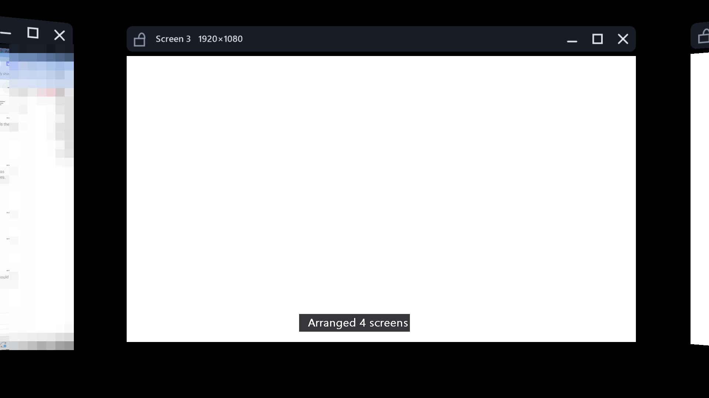
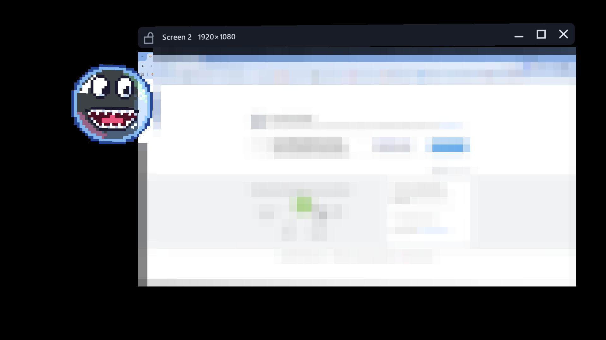
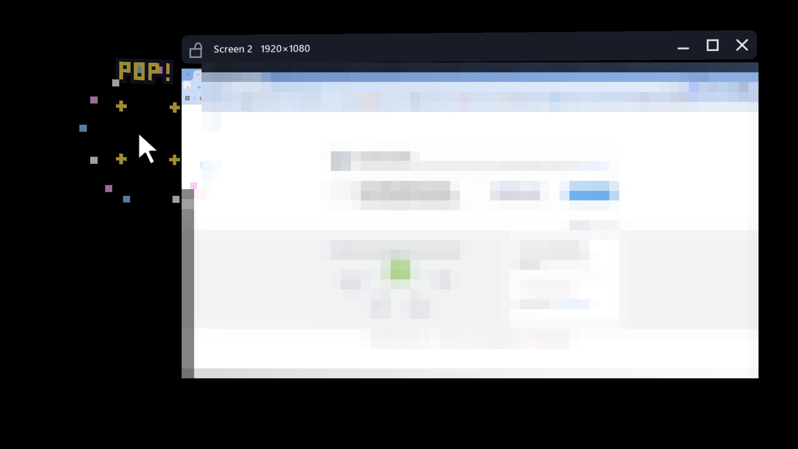
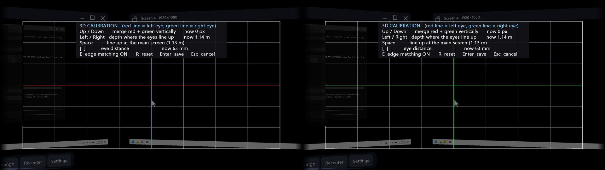

# AirBubble

**Floating PC screens and an AI buddy named Bubble, for XREAL Air glasses.** v1.7.2

Plug your XREAL Air straight into a Windows PC and your desktop turns into a room full of screens. Four (or up
to eight) full Windows displays float around you, stay put when you turn your head, and work like windows: move them,
resize them, push them away or pull them closer. Bubble, a little 16-bit buddy with a big toothy grin, floats
next to them and helps out when you call his name.

No phone, no Beam, no Unity, no XREAL SDK. Just the glasses, a USB-C cable and your PC.
*Formerly "PC Viewer for XREAL glasses". Not affiliated with XREAL.*

---

## Features

- **Screens that float.** Four by default, up to eight if you allow it in Settings. Every AR screen is a real
  Windows display. Drag a title bar to move it, roll the wheel
  to push or pull, drag an edge to resize, and use lock / minimize / maximize / close just like a normal window.
- **Head tracking.** 1000 Hz sensor tracking keeps screens still while you look around. Drift is learnt while you
  hold still and remembered between sessions.
- **Your own mouse in AR.** The mouse drives a cursor in the glasses. Over a screen, it clicks, scrolls and drags
  as normal, even from one screen to another.
- **Side-by-side 3D.** Screens get real depth, with a calibration tool to line up both eyes.
- **Bubble AI.** A voice assistant who can look at your screens, open apps and sites, search the web, remember
  things and set reminders. He asks before he does anything you didn't ask for.
- **A dock** under your line of sight: new screen, arrange, recenter, settings and minimized screens.

---

## Meet Bubble

Say **"Bubble"** (or press `Ctrl+Alt+B`) and talk. He answers out loud, shows a speech card, and his voice
carries his mood: laughs, sighs, gasps. His voice comes from where he floats, so it stays put when you turn
your head.

- **"Bubble, what's on my calendar?"** He can look at a screen and point at what to click.
- **"Bubble, remind me in 20 minutes to stretch."** Reminders and memory about you.
- **Big jobs:** he sends up to four helper bubbles (Pink, Green, Gold, Purple, Red, Orange, Teal) that work in
  parallel and report back in their own voices.
- **You choose how much he does on his own:** *Ask every time* (default), *Semi-autonomous* or *Fully
  autonomous*. In every mode he can't click Windows permission prompts, and risky actions always need a yes.
  Everything he does is logged in `%APPDATA%\AirBubble\bubble_actions.log`.

Click him to pop him. He stops talking at once and comes back when you say his name.

Bubble uses Claude for his brain and ElevenLabs for his voice. Add both API keys in **Settings > Bubble AI**.
Wake-word listening is done offline by Windows; only what you say to a bubble is sent out.

---

## 3D mode

Turn on side-by-side 3D in Settings and the glasses switch to 3840×1080, one half per eye. Press `Ctrl+Alt+K`
to calibrate: move the red (left eye) and green (right eye) lines until they merge, then press Enter.

---

## Install

1. Run **`dist\AirBubbleSetup.exe`** (Windows 10/11 x64, about 0.7 MB, nothing else needed).
   It installs the bundled virtual display driver with one admin prompt. Installing over the old
   "PC Viewer for XREAL glasses" replaces it and keeps your settings, API keys and layout.
2. Plug in the glasses and start **AirBubble** from the Start menu.
3. Hold your head still for about 2 seconds while it calibrates. Your screens appear in front of you.

Press `Ctrl+Alt+N` (or **+ New screen** in the dock) for more screens: four by default. For up to eight, tick
**Settings > Allow up to 8 screens (quality may be degraded)**. Every screen is captured and drawn live, so with
many screens open the glasses can get jittery, especially on integrated graphics (Intel UHD and similar). Changing
it asks for admin once and restarts AirBubble.

`Ctrl+Alt+G` gives the mouse back to the normal desktop at any time. `Ctrl+Alt+Q` quits and puts your
displays back the way they were.

> The installer is signed with a self-signed certificate, so SmartScreen may say "Windows protected your PC".
> Click *More info* > *Run anyway*, or run `Trust-Publisher.cmd` (admin) on PCs you own.

### Using it with the laptop lid closed
Install the **[Lid Watcher](LidWatcher/README.md)**. Closing the lid makes Windows reshuffle the displays,
which the viewer doesn't recover from yet; the watcher restarts it so your screens and Bubble come right back.

---

## Keys

| Keys | Action | Keys | Action |
|---|---|---|---|
| `Ctrl+Alt+G` | Mouse back to the PC (again to return) | `Ctrl+Alt+N` | New screen |
| `Ctrl+Alt+A` | Arrange screens in front of you | `Ctrl+Alt+R` | Recenter |
| `Ctrl+Alt+=` / `-` | Screen under the cursor closer / farther | `Ctrl+Alt+C` | Recalibrate (hold still) |
| `Ctrl+Alt+K` | 3D calibration | `Ctrl+Alt+S` | Settings |
| `Ctrl+Alt+B` | Talk to Bubble | `Ctrl+Alt+Y` / `N` | Answer Bubble yes / no |
| `Ctrl+Alt+Q` | Quit | | |

Full end-user guide: [USER_GUIDE.txt](USER_GUIDE.txt) (shipped with the installer).

---

## Credits

- **[Virtual Display Driver](https://github.com/VirtualDrivers/Virtual-Display-Driver)** by VirtualDrivers
  (MIT License): the virtual screens.
- **Claude** (Anthropic) is Bubble's brain and **ElevenLabs** is his voice.

---

## For developers

### Install details

- Per-user install to `%LOCALAPPDATA%\Programs\AirBubble`: Start menu shortcut, optional desktop shortcut,
  optional start-with-Windows (tray icon waits until the glasses are plugged in), entry in Settings › Apps.
- Installs the bundled **Virtual Display Driver** (one admin prompt) with a pool of 4 virtual screens. Uninstall
  removes it again, but only if this installer put it there. Settings > "Allow up to 8 screens" changes the pool
  (`Program.PendingScreens` → restart → elevated `AirBubble.exe --vdd-screens <n>` → `VddInstall.SetScreens`,
  which rewrites the config and restarts the device). Setup never lowers a pool the user raised; it raises a
  smaller one to `Product.VirtualScreens`. `Uninstall.exe /setscreens <1-8>` (elevated) does the same from setup.
- Silent: `AirBubbleSetup.exe /S [/desktop] [/noautostart] [/launch] [/nodriver] [/nouac] [/dir=PATH]`;
  `Uninstall.exe /uninstall /S [/keepsettings] [/keepdriver]`.
- Signed + timestamped with a **self-signed** certificate (`Installer\signing\`): proves the files weren't altered,
  but other PCs don't trust it. Removing the warning everywhere needs a CA certificate (paid) or free open-source
  signing (SignPath Foundation, requires a public open-source repo).
- Release package: `dist\AirBubble-<version>.zip` (installer, release notes, SHA-256, public certificate, trust script).
  Releases up to 1.6.4 are `dist\XrealPcViewer-<version>.zip`.
- The rename (1.7.0) kept a few internal names on purpose: the DPAPI entropy for `keys.dat` (`XrealPcViewer.keys`,
  or saved API keys can't be decrypted), the driver's `InstalledBy` marker (so uninstall still recognises a driver
  installed by an older version), the mutex/event names (so a new installer can stop an old viewer), the
  `HKLM\SOFTWARE\XrealPcViewer` UAC key, the `XrealDesktop.PcViewer` namespace and the signing certificate's name.
  Setup removes a pre-1.7 install (`Legacy` in `Setup.cs`); the viewer moves `%APPDATA%\XrealPcViewer` to
  `%APPDATA%\AirBubble` on first start (`Settings.MigrateDir`).

### Build

| Script | Output |
|---|---|
| `Installer\build.bat` | viewer + driver + installer → `dist\AirBubbleSetup.exe` |
| `Viewer\build.bat` | `Viewer\bin\AirBubble.exe` |
| `ImuTest\build.bat` | standalone sensor recorder (guided sessions with spoken cues) |

All use `csc.exe` from .NET Framework 4.8. For a release bump `Viewer\src\AssemblyInfo.cs`, `Product.Version` and the
assembly attributes in `Installer\Setup.cs`.

Signing: both build scripts call `Installer\signing\sign.ps1`, which signs with the certificate whose thumbprint is in
`thumbprint.txt` (CurrentUser\My on the build PC) and timestamps via DigiCert's free server. The private key exists
only on the build PC - back it up (certmgr.msc › Personal › Certificates › export with private key, password-protected)
or future builds will carry a different publisher. Without the certificate, builds still work, just unsigned.

### How it works

| Area | Implementation |
|---|---|
| Display | Glasses detected by EDID maker `MRG`; Windows switched to Extend; desktop arranged atomically with the CCD API (`DisplayConfig.cs`): `[PC screen] [main AR screen = primary at 0,0] [glasses] [other AR screens]`; everything restored on exit |
| Virtual screens | Bundled MIT Virtual Display Driver (EDID `MTT1337`), pool of 4, or 8 via Settings (config `%ProgramData%\XrealPcViewer\VirtualDisplayDriver\vdd_settings.xml`); showing/closing a screen = attaching/detaching that monitor (no driver reload) |
| Head tracking | 1000 Hz IMU over USB HID; Mahony filter (gravity levels pitch/roll); gyro bias learnt only from provably-still 1 s blocks, median of recent blocks, temperature slope, saved between sessions (`imu_bias.ini`) |
| Drift | No usable absolute yaw reference on the Air (magnetometer measured: unusable). Residual drift absorbed by "keep the main screen centred" — ≤3°/min, only while gazing at the main screen |
| Capture | DXGI Desktop Duplication per screen; zero-copy hand-off; frames queued with Windows' present timestamps and shown a fixed delay later (even video cadence) |
| Stabilization | Head "jitter buffer" (`Stabilizer.cs`): wobble inside a small cone (0.35/0.8/1.6 deg) is ignored apart from a slow catch-up; deliberate turns trail by at most the cone. Measured on a real recording: 2.3-3.6x steadier when still. `--stab-test file.csv` |
| Rendering | OpenGL, 60 Hz vsync, mono or side-by-side 3D (glasses switched to 3840×1080 via their control interface); head pose sampled after uploads; mipmaps rebuilt explicitly (`glGenerateMipmap`) |
| AR mouse | Low-level hook swallows the physical mouse; raw input drives the AR cursor; over a screen's content the real cursor is placed there and clicks/wheel are injected (tagged) |
| Window chrome | Title bars, dock and cursor drawn with GDI+ into textures; dock hangs under the main screen |

### Command line (diagnostics)

| | |
|---|---|
| `--autostart` | wait in the tray until the glasses are plugged in |
| `--quit` | close a running viewer cleanly (restores the desktop) |
| `--guard` | display helper: fixes the layout when the glasses are plugged in or unplugged |
| `--restore-desktop` | put the displays back to normal |
| `--display-mode read\|2d\|3d` | glasses display mode |
| `--detach-virtual` | turn all virtual screens off |
| `--selftest N [--fixed-head] [--video-load] [--3d]` | scripted run with log + `selftest_*.png` readbacks (`--fixed-head` = no need to wear the glasses) |
| `--replay file.csv [--saved]` | run an ImuTest recording through the real tracker |

Logs, settings, layout and calibration: `%APPDATA%\AirBubble\`.

### Hardware notes

- Tested on the original XREAL Air (USB `3318:0424`) with an Intel UHD laptop. Air 2 / 2 Pro / 2 Ultra are recognised
  from the open-source driver's ID table but untested (their sensor axes may differ).
- Control interface: only "read display mode" (0x07) and "write display mode" (0x08) are ever sent.
- 3DoF only: screens hold still when you turn your head, not when you lean.

### Known issues

- **Closing the laptop lid** loses a screen's capture and leaves the raw desktop in the glasses. Workaround:
  [LidWatcher](LidWatcher/README.md). Proper fix: handle display topology changes in `ViewerApp.cs` /
  `DisplayConfig.cs` by re-arranging the desktop and re-opening Desktop Duplication.

### Source layout

- `Viewer\src\ArDesktop.cs` – AR desktop: screens-as-windows, AR cursor, dock, rendering, drift absorption, self-tests
- `Viewer\src\ArScreens.cs` – screen model, hit-testing geometry, layout persistence
- `Viewer\src\InputHook.cs`, `Chrome.cs` – AR mouse; title bars/dock/cursor textures
- `Viewer\src\XrealImu.cs`, `XrealMcu.cs`, `XrealDevice.cs` – glasses sensors, display mode, device discovery
- `Viewer\src\DisplayConfig.cs`, `DisplaySetup.cs`, `VirtualScreens.cs`, `Guard.cs` – Windows display arrangement
- `Viewer\src\DesktopDuplication.cs`, `ScreenFeed.cs` – capture
- `Viewer\src\ViewerApp.cs` – entry point, run loop, cleanup; `Settings*.cs`, `Gl.cs`
- `Viewer\src\Bubble.cs`, `ArBubbles.cs` – Bubble and helper sprites, speech cards, pointing ring
- `Viewer\src\AiCrew.cs`, `AiClients.cs`, `AiVoice.cs`, `AudioOut.cs` – Bubble AI: Claude tool loop, helpers, memory/reminders; Claude + ElevenLabs over HTTPS; wake word, speech, spatial audio
- `Viewer\src\AiSafety.cs` – Bubble's autonomy modes (ask every time / semi / full): the app's own risk rating of each
  click, typed text, key press and opened target, the ask / don't-ask rule, and the action log.
  Tests: `--autonomy-test samples.txt out.txt` (offline ratings) and
  `--bubble-ask "..." --autonomy 0|1|2 --app-control --dry-run` (real Claude call, PC untouched)
- `Viewer\src\ElevatedWindows.cs`, `UacPrompts.cs` – administrator windows (click pass-through, cursor follow), UAC prompts in AR
- `Installer\Setup.cs`, `VddInstall.cs`, `vdd\` – installer, driver install, bundled driver + MIT license
- `ImuTest\` – sensor recorder; `*.csv` are the recordings used to design the drift handling
- `LidWatcher\` – workaround for closing the laptop lid (see its README)
- `docs\images\` – README screenshots (from `--selftest` readbacks, work content pixelated)
